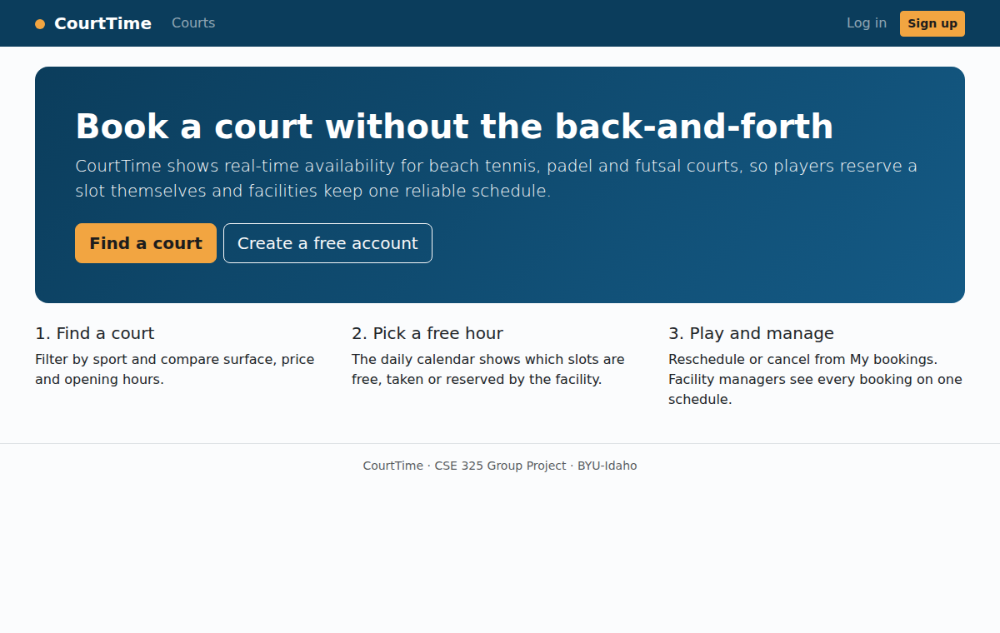

# CourtTime

A court booking system for small sports facilities (beach tennis, padel, futsal), built as a .NET Blazor web application for CSE 325 at Brigham Young University-Idaho, Fall 2026.

Players see real-time court availability and book a one-hour slot themselves. Facility managers register their courts and prices, block time for classes or maintenance, and run the day from one schedule that shows who is coming and who has paid.

## Features

| # | Feature | Who |
|---|---|---|
| 1 | Create an account and log in as a Player or Facility Manager | Everyone |
| 2 | Register a facility and add, edit, deactivate or delete courts (sport, surface, price, opening hours) | Facility Manager |
| 3 | Browse courts, filter by sport, and view a court's hour-by-hour availability for any day in the next 30 days | Everyone |
| 4 | Book a free time slot, with server-side protection against double bookings | Player |
| 5 | See upcoming bookings and history, reschedule or cancel a booking | Player |
| 6 | View the daily schedule for the facility and block time for classes, maintenance or events | Facility Manager |
| 7 | Mark bookings as paid, completed or no-show, and see the day's totals | Facility Manager |
| 8 | Edit the user profile (name, phone, preferred sport) | Everyone |

Full user instructions with screenshots are in [docs/USER_GUIDE.md](docs/USER_GUIDE.md). The original project proposal is in [PROPOSAL.md](PROPOSAL.md).

## Team

- Guilherme Prates Batista

## Technology Stack

- .NET 9 / Blazor Web App with server-side rendering and enhanced forms
- Entity Framework Core with SQL Server (LocalDB in development, Azure SQL in production)
- ASP.NET Core Identity with cookie authentication and roles
- Bootstrap 5 (served locally from `wwwroot/lib`)
- Deployment target: Azure App Service

## Getting Started

Requirements: .NET 9 SDK and SQL Server LocalDB (installed with Visual Studio, or with SQL Server Express).

    git clone https://github.com/guilhermeprates2258/cse325-group-project.git
    cd cse325-group-project/CourtTime
    dotnet run --launch-profile https

Open https://localhost:5001. On the first run the database is created automatically. In Development the app also adds a demo facility with four courts and two demo accounts:

| Role | Email | Password |
|---|---|---|
| Facility Manager | manager@courttime.test | CourtTime#2026 |
| Player | player@courttime.test | CourtTime#2026 |

The demo accounts exist only in the Development environment and are never created in production.

## Project Structure

    CourtTime/
      Components/
        Account/          Login, registration, profile, access denied, logout endpoint
        Layout/           Main layout with role-aware navigation
        Pages/            Home, court list, court availability, My bookings
        Pages/Manage/     Facility and court management, daily schedule
        Shared/           Status messages, redirects, display formatting
      Data/               ApplicationDbContext, ApplicationUser, roles, database initializer
      Models/             Facility, Court, Booking, BlockedSlot and enums
      Services/           BookingService (booking rules), FacilityService (manager operations), clock
      wwwroot/            Styles and Bootstrap
    docs/                 User guide and screenshots

## How Bookings Stay Consistent

All booking rules live in `Services/BookingService.cs`, so every page applies them the same way:

- Slots are one hour long, start on the hour, and must fall inside the court's opening hours.
- Only future slots up to 30 days ahead can be booked.
- A new booking is rejected if it overlaps another confirmed booking or a blocked slot. The check and the insert run inside one serializable database transaction, so two players clicking the same slot at the same moment cannot both succeed.
- Rescheduling creates the new booking and cancels the old one in the same transaction.
- Times are stored in the facility's time zone (`CourtTime:TimeZone` in `appsettings.json`, default `America/Sao_Paulo`), so "now" is correct even when the server runs in UTC.

## Security

- Passwords are hashed by ASP.NET Core Identity; accounts lock for a few minutes after 5 failed logins.
- Pages are protected with `[Authorize]` and role checks. Managers can only change their own facility's courts and bookings, and players can only change their own bookings; both rules are enforced in the services, not only in the UI.
- All forms use antiforgery tokens and server-side validation. Logout is a POST request.
- Login redirects only to local URLs, which prevents open redirects.
- Entity Framework Core uses parameterized queries.

## Accessibility

The interface targets WCAG 2.1 Level AA: semantic headings and landmarks, a skip-to-content link, labels on every form field, visible focus outlines, text alternatives for icon-only information, table captions, and colors checked for 4.5:1 contrast. Every page was audited with axe-core (WCAG 2.0/2.1 A and AA rules) with no violations, and layouts were checked at 390 px width for horizontal scrolling.

## Deploying to Azure App Service

1. Create an Azure SQL Database and an App Service (Windows or Linux, .NET 9).
2. In the App Service, open **Settings > Environment variables > Connection strings** and add `DefaultConnection` (type SQLAzure) with the Azure SQL connection string.
3. Publish from the `CourtTime` folder:

        dotnet publish -c Release -o publish
        az webapp deploy --resource-group <group> --name <app-name> --src-path publish --type zip

   Visual Studio's **Publish** wizard works as well.
4. On the first request the app creates the database schema and the Player and FacilityManager roles. Register a Facility Manager account to set up the first facility.

## Branching Model

- `main` stays deployable at all times.
- Work happens on feature branches named `feature/short-description` and reaches `main` through a reviewed pull request.

## Project Management

Features and tasks are tracked on the Trello board: https://trello.com/b/xDjtmoAJ/cse-325-group-project

## License

MIT
