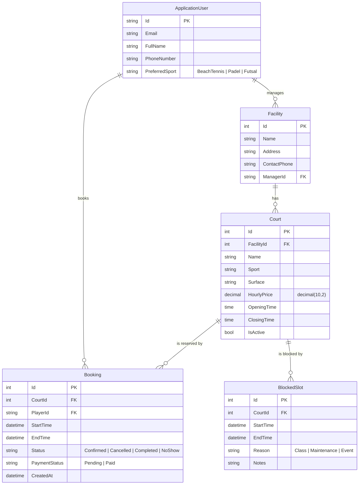

# CourtTime — Data Model (ERD)

Entities live in `src/CourtTime/Models` and `src/CourtTime/Data`, and are mapped by `ApplicationDbContext`.
Enums are stored as strings so the database stays readable.

## Rules enforced by the database

| Rule | How |
|---|---|
| A booking ends after it starts | Check constraint `CK_Booking_EndAfterStart` |
| A blocked slot ends after it starts | Check constraint `CK_BlockedSlot_EndAfterStart` |
| Fast "bookings for court X on day Y" lookups | Index on `Booking (CourtId, StartTime)` and `BlockedSlot (CourtId, StartTime)` |
| Deleting a facility removes its courts, bookings and blocked slots | Cascade delete Facility → Court → Booking / BlockedSlot |
| Deleting a user never silently deletes facilities or booking history | Restrict delete on `Facility.ManagerId` and `Booking.PlayerId` |

Double bookings are prevented in the booking service (W05) by checking for overlapping
bookings and blocked slots inside the same transaction that saves the new booking.

## Roles

| Role | Can do |
|---|---|
| `Player` | Browse courts, book slots, manage own bookings and profile |
| `FacilityManager` | Manage own facility's courts, block slots, mark bookings as paid / no-show |

Roles are created on startup by `DbInitializer`; users pick their role on the Register page.
