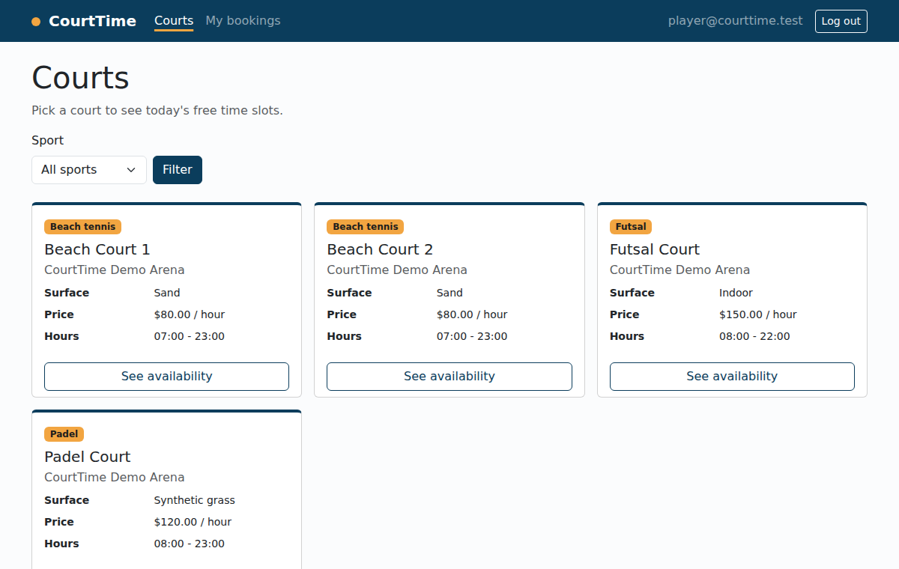
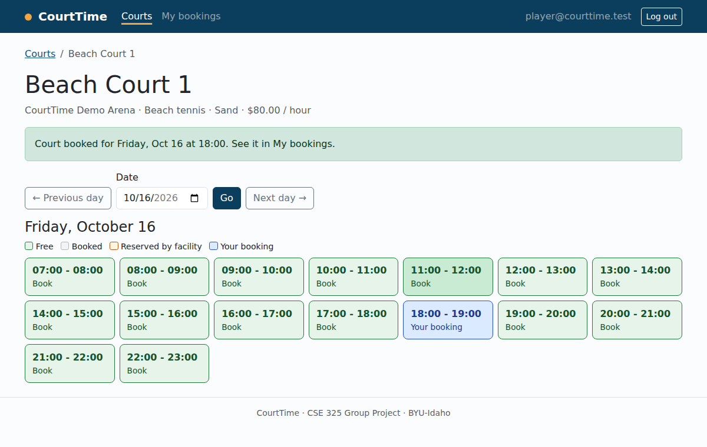
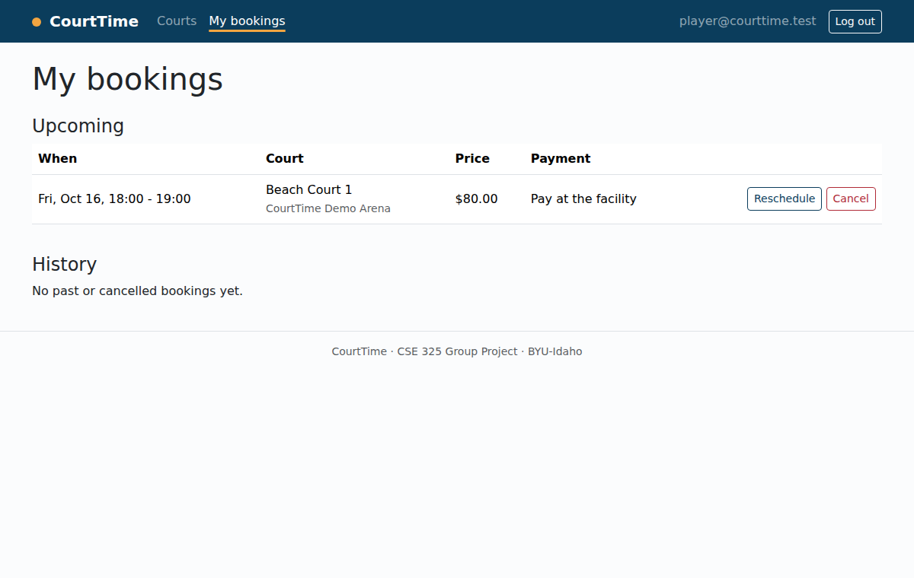
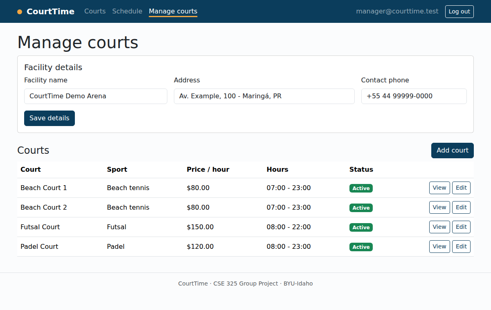
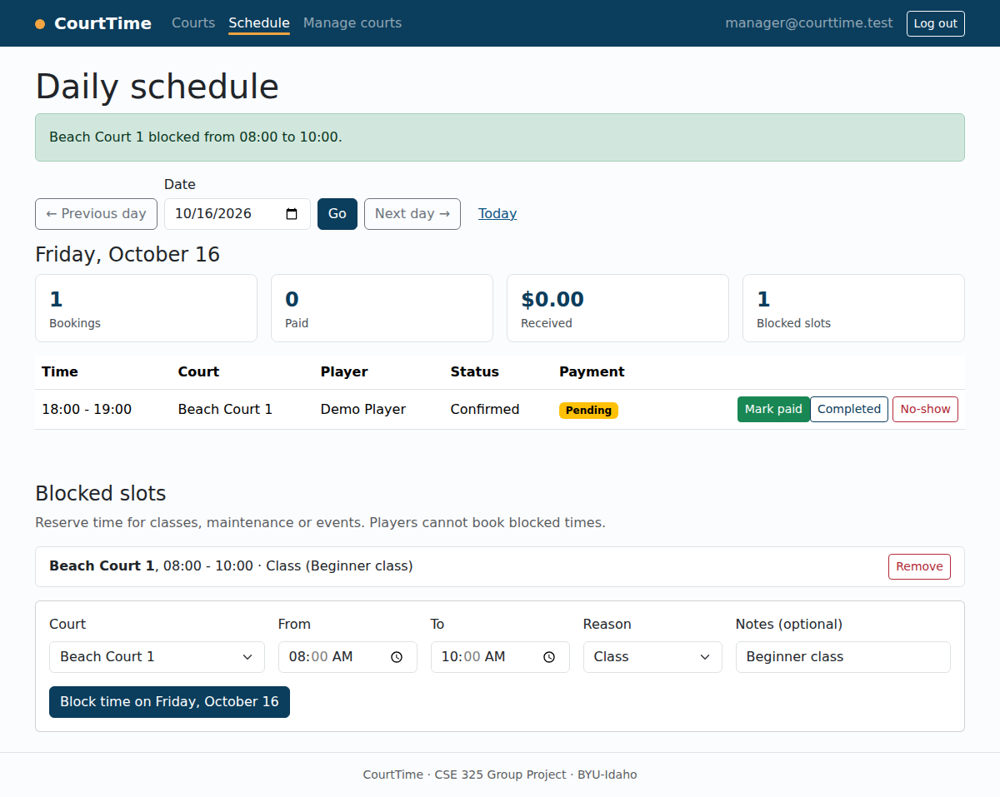
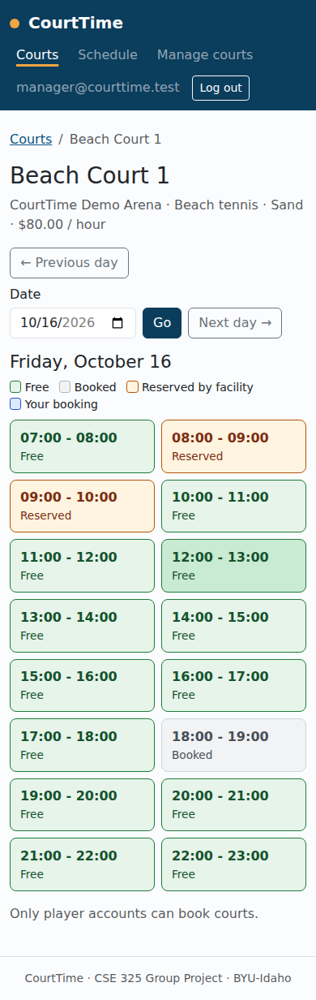

# CourtTime User Guide

CourtTime has two kinds of accounts. **Players** book courts. **Facility managers** run a facility and its courts. Anyone can browse courts and availability without an account.

## Creating an account

1. Select **Sign up** in the top bar.
2. Choose **Book courts (Player)** or **Manage my facility's courts (Facility manager)**.
3. Enter your name, email, an optional phone number and a password (at least 8 characters with upper and lower case letters, a number and a symbol).
4. Select **Create account**. You are signed in right away.

To sign in later, select **Log in**. Select your email in the top bar to open **My profile**, where you can change your name, phone and preferred sport. Select **Log out** to end the session.

## For players

### Find a court

Open **Courts** to see every active court with its sport, surface, price per hour and opening hours. Use the **Sport** filter to narrow the list, then select **See availability**.

### Book a time slot

The availability page shows one box per hour:

- **Green (Book)**: free. Select it to book.
- **Grey (Booked)**: taken by another player, or already in the past.
- **Orange (Reserved)**: blocked by the facility for a class, maintenance or an event.
- **Blue (Your booking)**: your own booking.

Use **Previous day**, **Next day** or the date picker to change the day. You can book up to 30 days ahead. If another player books the same slot a moment before you, CourtTime tells you and keeps the calendar up to date.

### Manage your bookings

Open **My bookings** to see upcoming bookings and your history.

- **Reschedule** opens the court's calendar in "move" mode. Pick a new free slot and your booking moves there; the old slot is released at the same time.
- **Cancel** releases the slot for other players. Only upcoming bookings can be cancelled.

Payment is made at the facility. The **Payment** column changes to **Paid** when the manager records it.

## For facility managers

### Set up your facility and courts

1. Open **Manage courts**.
2. Fill in **Facility details** (name, address, contact phone) and select **Register facility**.
3. Select **Add court** and enter the court's name, sport, surface, price per hour and opening hours. Leave **Active** checked so players can book it.

To change a court, select **Edit**. Uncheck **Active** to stop new bookings without losing history. **Delete court** removes a court that has never been booked; courts with bookings are deactivated instead, so players keep their records.

### Run the day

Open **Schedule** to see every booking for a day, with the player's name and phone. The cards at the top show the number of bookings, how many are paid, the amount received and the number of blocked slots.

- **Mark paid** records payment (use **Undo paid** to reverse it).
- **Completed** marks a booking as played.
- **No-show** records that the player did not come.

### Block time

At the bottom of **Schedule**, choose a court, a start and end time, a reason and optional notes, then select **Block time**. Players see the blocked hours as **Reserved** and cannot book them. If a block overlaps existing bookings, CourtTime warns you so you can contact those players. Select **Remove** to free the time again.

## Using CourtTime on a phone

Every page adapts to small screens. The availability boxes wrap to fit the screen, and wide tables scroll sideways inside their own area.

